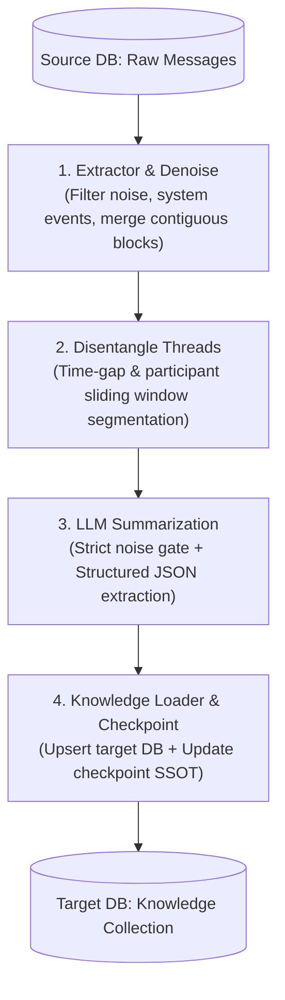

# Wisdom (智慧)

[正體中文](README.zh-TW.md) | English

> **Technical knowledge extraction pipeline**  
> From Web-Tech-TW  
> Meticulously crafted — a technical chat extraction and structured knowledge pipeline powered by open-source AI

Wisdom is the data engineering and knowledge extraction pipeline of the Nymph ecosystem, operated and maintained by the Taiwan Web Technology Promotion Organization (Web Tech TW). It specializes in parsing, denoising, disentangling, and summarizing technical community discussions into structured knowledge documents and architecture decision records, continuously feeding the AI consultant retrieval system.

---

## Core Architecture & Workflow

Wisdom processes raw chat streams through a four-stage pipeline:



1. **Extraction & Denoising (`tasks/extractor.ts`)**:
   * Pre-indexes a global author registry from historical system events.
   * Strips out casual banter, bot triggers, sticker notifications, and system noise.
   * Merges contiguous messages from the same author within tight time windows.
2. **Thread Disentanglement (`tasks/disentangle.ts`)**:
   * Segments interleaved, multi-topic group discussions into cohesive technical discussion threads based on temporal clustering and participant overlap.
3. **LLM Technical Summarization (`tasks/summarizer.ts`)**:
   * Applies a strict `hasTechnicalKnowledge` evaluation gate.
   * Leverages structured outputs (`json_schema`) to extract technical category, concise topic, problem background, evaluated attempts, consensus conclusion, action items, code snippets, and tags.
4. **Knowledge Loading & Checkpoints (`tasks/loader.ts`)**:
   * Upserts formatted Markdown documents into the target MongoDB knowledge collection.
   * Maintains persistent date-level processing checkpoints directly in the database as the Single Source of Truth (SSOT), supporting seamless resumption.

---

## Quick Start

### 1. Prerequisites

* [Bun](https://bun.sh/) (>= 1.2)
* Target MongoDB instance (storing extracted knowledge and checkpoints)
* Source MongoDB instance (containing raw chat message archives)
* An OpenAI-compatible LLM endpoint (e.g. Ollama, vLLM, or compatible gateway)

### 2. Installation

```bash
bun install
```

### 3. Environment Configuration

Copy `.env.sample` to `.env` and fill in your connection details:

```bash
cp .env.sample .env
```

| Variable | Description | Default / Example |
| :--- | :--- | :--- |
| `MONGODB_URI` | Connection URI for the target knowledge database | `mongodb://localhost:27017/nymph` |
| `SOURCE_MONGODB_URI` | Connection URI for the raw chat messages database | `mongodb+srv://.../openchat` |
| `SOURCE_MONGODB_DB_NAME` | Database name of the source archive | `openchat` |
| `SOURCE_MONGODB_COLLECTION`| Collection name of raw chat messages | `messages` |
| `ETL_OPENAI_BASE_URL` | Base URL of the OpenAI-compatible LLM endpoint | `https://integrate.api.nvidia.com/v1` |
| `ETL_OPENAI_API_KEY` | API key for the LLM endpoint | `your_etl_openai_api_key` |
| `ETL_OPENAI_MODEL` | Model identifier for extraction & summarization | `openai/gpt-oss-20b` |
| `ETL_CONCURRENCY` | Maximum concurrent LLM requests during batching | `3` |

---

## CLI Usage

Wisdom provides a CLI interface (powered by [Commander.js](https://github.com/tj/commander.js)) with built-in checkpoint resumption and flexible filters:

### Run Full Production Pipeline
Resumes processing from the last recorded checkpoint and writes extracted knowledge into the target database:

```bash
bun run etl
```

### Dry Run (Preview Mode)
Simulates extraction and prints preview Markdown knowledge slices to stdout without modifying target database records:

```bash
bun run etl:dry-run
```

### Advanced Options

* **Process limited days**: Process only the earliest N unprocessed days:
  ```bash
  bun run etl --days=7
  ```
* **Filter by specific date or month**:
  ```bash
  bun run etl --date="2026.10"
  ```
* **Override concurrency**:
  ```bash
  bun run etl --concurrency=5
  ```
* **Fresh start (ignore checkpoints)**:
  ```bash
  bun run etl --fresh
  ```

---

## Code Quality & Testing

```bash
# Run ESLint check
bun run lint

# Automatically fix linting issues
bun run lint:fix

# Run tests
bun test
```

---

## License

This project is licensed under the [MIT License](LICENSE).

---

&copy; [Taiwan Web Technology Promotion Organization](https://web-tech.tw)
