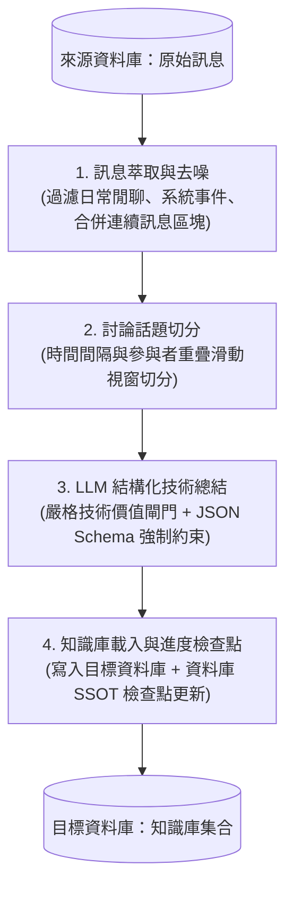

# Wisdom (智慧)

正體中文 | [English](README.md)

> **技術知識萃取管線**  
> 來自 Web-Tech-TW  
> 匠心打造 以開源 AI 技術驅動的技術對話分群與結構化知識管線

Wisdom 是 Nymph 生態系中的資料工程與知識庫萃取管線服務，由臺灣網際網路技術推廣組織（Web Tech TW）營運與維護。專責處理技術社群日常對話的解析、去噪、話題分群與結構化總結，持續為技術顧問檢索系統沉澱高品質的工程決策紀錄與除錯排障知識。

---

## 核心架構與處理管線

Wisdom 將原始群聊訊息流劃分為四個處理階段：



1. **訊息萃取與去噪 (`tasks/extractor.ts`)**：
   * 預先自歷史系統事件建立全域發言者識別索引。
   * 過濾貼圖、機器人觸發指令、無意義問候與群組系統事件等雜訊。
   * 將同一位發言者在短時間內的連續發言合併為語意完整的發言區塊。
2. **討論話題切分 (`tasks/disentangle.ts`)**：
   * 依據發言時間間隔與參與成員重疊度，將群組中交錯並行發生的多線討論精準切分為獨立的技術對話討論串。
3. **LLM 結構化技術總結 (`tasks/summarizer.ts`)**：
   * 內建嚴格的 `hasTechnicalKnowledge` 價值篩選閘門，無實質排障或技術討論者直接過濾。
   * 啟用結構化輸出（Structured Outputs / `json_schema`），精準提取技術分類、簡潔主題、問題背景、嘗試解法與評估結果、結論共識、待辦清單、代碼片段與標籤。
4. **知識庫載入與進度檢查點 (`tasks/loader.ts`)**：
   * 將排版完成的 Markdown 知識條目以 Upsert 機制寫入目標 MongoDB 知識庫集合。
   * 將日期處理進度直接保存於資料庫中作為單一真實來源（SSOT），支援中斷後精準續跑。

---

## 快速上手

### 1. 環境需求

* [Bun](https://bun.sh/) (>= 1.2)
* 目標 MongoDB 資料庫（用於儲存萃取完成之知識文件與檢查點）
* 來源 MongoDB 資料庫（存放社群原始聊天訊息封存紀錄）
* 一組 OpenAI 相容規格之 LLM 端點（如 Ollama、vLLM 或相容推論網關）

### 2. 安裝依賴套件

```bash
bun install
```

### 3. 環境變數設定

複製 `.env.sample` 為 `.env` 並填入對應連線資訊：

```bash
cp .env.sample .env
```

| 變數名稱 | 說明 | 預設 / 範例值 |
| :--- | :--- | :--- |
| `MONGODB_URI` | 目標知識庫 MongoDB 連線位址 | `mongodb://localhost:27017/nymph` |
| `SOURCE_MONGODB_URI` | 來源聊天紀錄 MongoDB 連線位址 | `mongodb+srv://.../openchat` |
| `SOURCE_MONGODB_DB_NAME` | 來源資料庫名稱 | `openchat` |
| `SOURCE_MONGODB_COLLECTION`| 來源訊息集合名稱 | `messages` |
| `ETL_OPENAI_BASE_URL` | OpenAI 相容推論端點 URL | `https://integrate.api.nvidia.com/v1` |
| `ETL_OPENAI_API_KEY` | 推論端點 API 金鑰 | `your_etl_openai_api_key` |
| `ETL_OPENAI_MODEL` | 萃取總結專用模型識別碼 | `openai/gpt-oss-20b` |
| `ETL_CONCURRENCY` | 批次處理時向 LLM 發起請求之最大並行度 | `3` |

---

## 命令列工具（CLI）用法

Wisdom 內建完整的 CLI 指令（採用 [Commander.js](https://github.com/tj/commander.js) 構建）與斷點續跑機制：

### 執行全量正式管線
從上次成功處理的日期斷點接續執行，並將萃取完成之知識寫入目標資料庫：

```bash
bun run etl
```

### 乾跑預覽模式（Dry Run）
模擬管線運算與 LLM 總結，並於終端機輸出 Markdown 格式預覽，不會寫入目標資料庫：

```bash
bun run etl:dry-run
```

### 進階參數範例

* **限制處理天數**：僅處理最早未完成的 N 個日期：
  ```bash
  bun run etl --days=7
  ```
* **依特定日期或月份篩選**：
  ```bash
  bun run etl --date="2026.10"
  ```
* **自訂並行請求數**：
  ```bash
  bun run etl --concurrency=5
  ```
* **忽略檢查點全新重跑**：
  ```bash
  bun run etl --fresh
  ```

---

## 代碼品質與測試

```bash
# 執行 ESLint 語法檢查
bun run lint

# 自動修復語法格式問題
bun run lint:fix

# 執行單元測試
bun test
```

---

## 開放原始碼授權

本專案採用 [MIT License](LICENSE) 開源授權。

---

&copy; [Taiwan Web Technology Promotion Organization](https://web-tech.tw)
